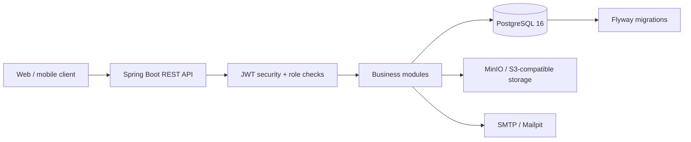
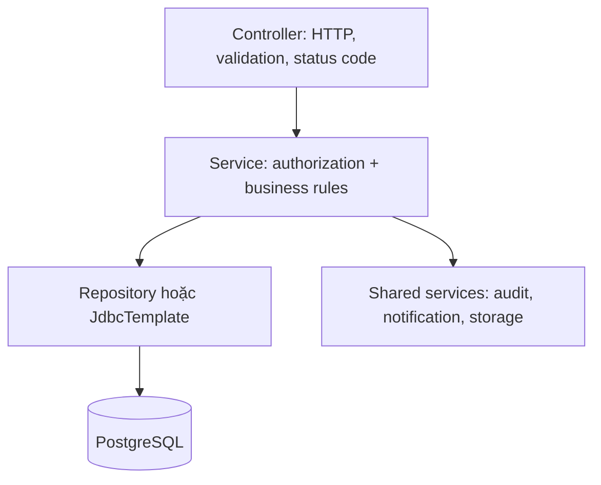

# Kiến trúc TutorHub

## Tổng quan

TutorHub là backend REST cho nền tảng kết nối phụ huynh và gia sư. Ứng dụng là **modular monolith**: một Spring Boot process, một PostgreSQL database, nhưng source được chia theo nghiệp vụ để mỗi module có controller, service, DTO và lớp truy cập dữ liệu riêng.



Mã nguồn nằm trong `com.tutorhub`; điểm vào là `TutorHubApplication`. Java 21, Spring Boot 3.5, Maven và PostgreSQL là nền tảng chính. API dùng tiền tố `/api/v1`.

## Các lớp và quy tắc phụ thuộc



- Controller chỉ nhận/trả DTO; entity JPA không được trả trực tiếp ra API.
- Service thực hiện kiểm tra role và quyền sở hữu tài nguyên. Khi việc tiết lộ sự tồn tại của tài nguyên là không cần thiết, service trả `404`.
- Module gọi service của module khác hoặc shared service; không truy cập repository của module khác.
- `GlobalExceptionHandler` chuẩn hóa lỗi về `ApiError` gồm `code`, `message`, `details` và `timestamp`.
- `JdbcTemplate` được dùng cho các thao tác nghiệp vụ cần SQL atomic hoặc query đọc chuyên biệt; JPA repository vẫn được dùng cho aggregate đơn giản.

## Module nghiệp vụ

| Module | Trách nhiệm |
|---|---|
| `auth`, `user` | Đăng ký, xác minh email, đăng nhập JWT, refresh-token rotation, mật khẩu, avatar, soft delete user. |
| `catalog` | Danh mục môn học và quận/huyện công khai. |
| `parent` | Hồ sơ phụ huynh và quản lý children. |
| `tutor` | Hồ sơ, môn dạy, lịch rảnh, giấy tờ, tìm kiếm công khai và trạng thái xác minh. |
| `request` | Yêu cầu tìm gia sư, ứng tuyển, accept/reject/withdraw và job đóng yêu cầu hết hạn. |
| `booking` | Buổi học đơn lẻ/định kỳ, state machine, kiểm tra availability và cancellation window. |
| `review` | Đánh giá sau buổi học hoàn tất và phản hồi của gia sư. |
| `chat` | Conversation, message, read state và cảnh báo nội dung liên hệ/thanh toán ngoài nền tảng trước khi có booking confirmed. |
| `notification`, `report`, `admin` | Notification in-app, report, kiểm duyệt, quản trị user/review và dashboard. |
| `common` | Security, config, exception, pagination, audit, object storage, correlation ID. |

## Xác thực và phân quyền

`SecurityConfig` dùng session stateless. `JwtAuthenticationFilter` đọc Bearer access token, tạo `UserPrincipal`, rồi đặt role `ROLE_PARENT`, `ROLE_TUTOR` hoặc `ROLE_ADMIN` vào Spring Security context.

Các endpoint auth, Swagger, health và GET catalog/tutor công khai. Endpoint còn lại yêu cầu JWT. Các endpoint admin dùng `@PreAuthorize("hasRole('ADMIN')")`; service vẫn chịu trách nhiệm kiểm tra ownership hoặc trạng thái nghiệp vụ.

Access token được ký HS256. Refresh token chỉ lưu SHA-256 hash trong database, được xoay vòng khi refresh và thu hồi khi logout/đổi mật khẩu. Mật khẩu dùng BCrypt.

## Dữ liệu và migration

PostgreSQL là source of truth. JPA chạy với `ddl-auto=validate`; schema chỉ được thay đổi bằng Flyway. `V1__init_schema.sql` và `V2__seed_reference_data.sql` là migration đã áp dụng và không được sửa; schema mới phải dùng migration tuần tự tiếp theo.

Các quan hệ dữ liệu quan trọng:

- `users` là tài khoản gốc, với profile `parent_profiles` hoặc `tutor_profiles` theo role.
- `tutor_subjects`, `tutor_availability`, `tutor_documents` mở rộng hồ sơ gia sư.
- `tutor_requests` và `applications` giữ quy trình tìm gia sư; một partial unique index bảo đảm chỉ một application được accept cho mỗi request.
- `bookings` liên kết parent, tutor, child và subject. `reviews` có tối đa một hàng cho mỗi booking.
- `conversations`/`messages`, `notifications`, `reports` và `audit_logs` giữ dữ liệu vận hành.

Tiền tệ dùng `BIGINT` (VND); thời gian dùng `TIMESTAMPTZ` ở database và `Instant` trong Java.

## Booking và tính nhất quán

Booking là luồng có yêu cầu đồng thời cao nhất. Service kiểm tra tutor đã verified, môn dạy, child ownership, lịch rảnh, thời điểm tương lai và thời lượng 30–240 phút trước khi insert.

Database mới là lớp bảo vệ cuối cùng: exclusion constraint `ex_bookings_no_overlap` trên `bookings` ngăn hai booking PENDING/CONFIRMED/COMPLETED của cùng gia sư bị trùng thời gian. Service bắt vi phạm constraint và trả `409 BOOKING_OVERLAP`; không dùng kiểu kiểm tra `SELECT` trước rồi mới insert.

Trạng thái được quản lý bởi `BookingStateMachine`:

```text
PENDING   -> CONFIRMED | CANCELLED
CONFIRMED -> COMPLETED | CANCELLED | NO_SHOW
```

Recurring booking tạo từng occurrence trong transaction riêng: occurrence lỗi được trả về trong danh sách lỗi nhưng không rollback các buổi đã tạo.

## Tích hợp ngoài và vận hành

- PostgreSQL, MinIO và Mailpit chạy cục bộ qua `docker-compose.yml`.
- `FileStorage` cô lập MinIO: service lưu object key trong database và phát signed URL có hạn để đọc giấy tờ.
- `CorrelationIdFilter` trả `X-Correlation-Id` cho mỗi request để liên kết log.
- Actuator công khai `health` và `metrics`; Swagger ở `/swagger-ui.html`.
- `docker-compose.prod.yml` là khung triển khai với app, PostgreSQL và Caddy; xem [backup.md](backup.md) để backup database.

## Cấu hình

`application.yml` nhận cấu hình qua biến môi trường: database, JWT, admin bootstrap, MinIO, CORS và `BOOKING_CANCELLATION_MINUTES`. Không commit `.env` hoặc bất kỳ secret nào. Môi trường dùng profile `dev`, `test`, và `prod`.

## Kiểm thử

Unit test đặt cạnh module. Integration test kế thừa `PostgresIntegrationTest` và dùng Testcontainers PostgreSQL để chạy Flyway cùng schema thật. Khi Docker không hoạt động, các integration test được skip; CI nên có Docker để thực thi chúng.
